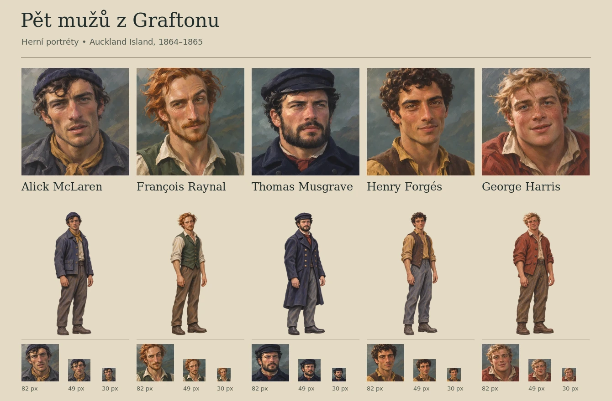

# Pět tváří Graftonu

Alick s přimhouřeným okem poslouchá člověka před sebou. Raynal naklonil hlavu a zvedá jedno obočí. Musgrave pozoruje něco za partnerovým ramenem. Henry začíná úsměv jen jedním koutkem, George na odpověď teprve čeká. Výrazy, tváře a barvy oděvů vznikly jako výtvarné obsazení pro hru. Historické údaje o jednotlivých mužích uvádějí samostatné [životopisné karty](../research/CREW.md).

| Postava | Rozpoznávací znak v malém okénku | Samostatné obrazy |
|---|---|---|
| Alick McLaren | Tmavé kudrny vybíhají pod nízkou čapkou, okrový šátek zasahuje do modré kazajky. | [Rozhovor](dist/assets/cast-portraits/player.webp) · [celá postava](dist/assets/sailor.png) |
| François Raynal | Úzká tvář, měděné obočí, vous a knír. Světlý límec nad zelenou vestou. | [Rozhovor](dist/assets/cast-portraits/raynal.webp) · [celá postava](dist/assets/people/raynal.png) |
| Thomas Musgrave | Štítek čepice a zastřižený černý vous rámují hranatou tvář. Krk lemuje cihlově červená vázanka. | [Rozhovor](dist/assets/cast-portraits/musgrave.webp) · [celá postava](dist/assets/people/musgrave.png) |
| Henry Forgés | Velká silueta tmavých kudrn, hladká brada a košile v teplém okru. | [Rozhovor](dist/assets/cast-portraits/henry.webp) · [celá postava](dist/assets/people/henry.png) |
| George Harris | Široká pihovatá tvář, světlé rozcuchané vlasy a krémový límec na červené. | [Rozhovor](dist/assets/cast-portraits/george.webp) · [celá postava](dist/assets/people/george.png) |

## Jak vznikly obrazy

Každá tvář má vlastní čtvercovou malbu vytvořenou nástrojem OpenAI ImageGen. Původní PNG mají 1254 × 1254 px. Pro hru se celý čtverec zmenšil na 640 × 640 px a uložil do WebP. Všech pět herních souborů zabírá dohromady 273 006 bajtů. Světlo přichází zleva a teplé odstíny kůže vystupují z šedomodrého pozadí. [Původní čtvercové malby](artwork/portraits) · [Kontrolní součty a názvy výstupů](dist/assets/cast-portraits/manifest.json) · [Přesná zadání](dist/assets/cast-portraits/prompts.json)

Pro každý z pěti celopostavových obrazů dostal generátor dvě reference téže postavy. Detail mu dal rysy obličeje a pohybová studie střih oblečení včetně kalhot a obuvi. Stojící postavy jsou dostupné v původních průhledných PNG. Při rozhovorech i na vzpomínkové desce v závěru hra používá pět čtvercových portrétů, které zachovávají výraz i v malém rozměru. Jejich neprůhledné siluety vymezují jednotlivé zobrazovací výřezy. [Manifest celých postav](dist/assets/people/manifest.json) · [Zadání se zdrojovými součty](dist/assets/people/prompts.json) · [Pohybové studie](artwork/cast)

## Kontrola ve zmenšení

Dolní řada galerie používá šířky 82, 49 a 30 skutečných pixelů při zobrazení desky 1 : 1. Na 49 px jsou dobře rozeznatelné tvary hlav, pokrývky hlavy, vousy a převažující barvy košil. Na 30 px u George ustupují pihy a u Henryho jemný pohyb koutku. Rozeznatelnost v nejmenší velikosti podpírají vlasy a límce. U celopostavových PNG mají rohy alfu 0 z 255 s jedinou výjimkou. Levý horní pixel Musgraveova originálu má alfu 1 z 255. Galerie je montáž dodaných obrazů před rozvržením herního okna. [Galerie v plném rozlišení](reviews/portraits/posadka.webp) · [Kontrola vazeb mezi soubory](tests/cast-portraits.test.cjs)
