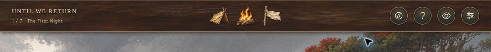
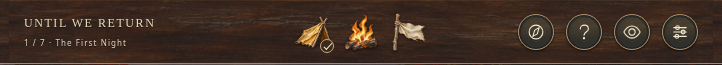

# Malované materiály rozhraní

Šest materiálů rozhraní má vlastní atlas. Jeho souborové vlastnosti, souřadnice a prahové hodnoty alfa kanálu uvádí manifest. Text a obsah inventáře doplňuje aplikace. Malby prostředí a pracovní detaily jsou evidované zvlášť. [Manifest atlasu rozhraní](dist/assets/ui/atlas.json) · [Výtvarná a povětrnostní kontrola](reviews/26-weather-and-art.md)

## Cíle v lodním deníku

Uprostřed dřevěné lišty jsou vždy tři kvašové miniatury. První noc představují přístřešek ze zachráněné plachty, oheň na polenech a světlý cíp plátna uvázaný na tyči. V kovárně jejich místo zaujmou měch, žhavé železo v kleštích a tři vykované hřeby. Po splnění dostane příslušná kresba světlou fajfku na tmavé pečeti. Anglický název cíle a jeho stav jsou dostupné také čtečce a při podržení ukazatele.

Jednadvacet ilustrací vzniklo pro tuto hru pomocí ImageGen. Při malbě signálu, měchu na vodu a mapy sloužily jako předloha skutečné výtvarné podklady hry. Průhledný atlas WebP má 432 × 1008 px, sedm řádků odpovídá sedmi kapitolám. Každá miniatura má vlastní buňku 144 × 144 px. [Atlas cílů](dist/assets/ui/journal-goals.webp)

Na začátku první noci ukazuje veřejná hra přístřešek z plachty, oheň a signál na břehu.



Skutečná lišta po postavení přístřešku při šířce okna 724 px. V Chromiu jsme kontrolovali také rozložení při šířkách 320, 375, 640, 844 a 1280 px.



## Archiv z 16. listopadu 2026

Výtvarné zadání navázalo na jemné grafitové obrysy, kvašovou kresbu a opotřebené materiály tehdejších ilustrací `sailor.png` a `camp.png`. Výsledný atlas obsahoval tmavé lodní dřevo, plátno s koženým okrajem, list papíru, zavřenou brašnu, prázdné mosazné tlačítko a papírový štítek. Povrchy byly záměrně klidné, aby na nich zůstal čitelný text a inventář.

### Soubory a původ

- `dist/assets/ui/castaway-ui-atlas.png` byl v této verzi přesnou kopií výstupu `image_gen.imagegen`. Měl režim RGBA a rozměry **1536 × 1024 px**, se třemi sloupci a dvěma řádky po 512 px.
- `dist/assets/ui/atlas.json`: hash, souřadnice buněk, přesné alpha bounds při několika prahových hodnotách a doporučené výřezy.
- `dist/assets/ui/generation-prompts.json`: celé zadání, referenční soubory a druhý experiment s čištěním průhlednosti. Druhý výstup nebyl přijat; původní atlas má klidnější materiálové textury.

Před generováním byly prohlédnuty vlastní předlohy projektu. Nebyly použity knihovní ikony ani stažené ilustrace. Nýty a uzávěr brašny jsou součástí této výtvarné interpretace.

SHA-256 atlasu z 16. listopadu 2026

```text
1f4e0dc8fa557ae200229a35e9192812016c739fc7435aa13b6b07953367f292
```

### Souřadnice pro integraci v původním atlasu

Počátek souřadnic je vlevo nahoře. `viewBox` je `x y šířka výška` v původním atlasu. Výřez zahrnuje hranice viditelného materiálu při alpha ≥ 32 a čtyřpixelový přesah. Zachovat poměr stran; dřevo či plátno lze při potřebě širokého pruhu opakovat nebo záměrně roztáhnout v aplikaci, papír má sloužit jako podklad dialogu. Zdroje se na disku neořezávaly ani nepřevzorkovávaly.

| Prvek | Buňka, sloupec/řádek od 0 | Doporučený `viewBox` | Alpha ≥ 32: atlas `[left, top, right, bottom)` |
| --- | --- | --- | --- |
| `timber-strip` | 0 / 0 | `12 182 493 191` | `[16, 186, 501, 369)` |
| `inventory-canvas` | 1 / 0 | `522 142 490 261` | `[526, 146, 1008, 399)` |
| `dialog-paper` | 2 / 0 | `1031 94 491 353` | `[1035, 98, 1518, 443)` |
| `satchel` | 0 / 1 | `66 580 382 365` | `[70, 584, 444, 941)` |
| `brass-button` | 1 / 1 | `604 596 323 329` | `[608, 600, 923, 921)` |
| `paper-tab` | 2 / 1 | `1059 675 441 183` | `[1063, 679, 1496, 854)` |

Příklad použití bez změny zdrojového PNG:

```html
<svg viewBox="12 182 493 191" aria-hidden="true">
  <image href="assets/ui/castaway-ui-atlas.png" width="1536" height="1024" />
</svg>
```

Dekorativní SVG skrýt před čtečkou obrazovky; skutečné tlačítko i jeho přístupný název řešit v HTML. Volný střed mosazného tlačítka lze překrýt funkčním textem či ikonou aplikace. Nový text nevypalovat do původního atlasu.

### Tehdejší kontrola průhlednosti

U původního PNG byl naměřen alfa kanál s rozsahem **0–254**. Většina vnitřních pixelů materiálu měla hodnoty 252–253. Mimo fyzické obrysy zůstávaly rozptýlené pixely s hodnotami 1–31, místy až k hranicím buněk. Hranice při prahových hodnotách 32, 128, 200 a 250 dovolují zvolit těsnější výřez. [Manifest s měřením](dist/assets/ui/atlas.json)

Pillow zde sloužil pouze ke kontrole rozměrů, alfa kanálu a kontrolního součtu. Druhé zadání pro generátor mělo vyčistit průhlednost. Výsledek stále obsahoval slabou okrajovou kresbu a zvýraznil texturu. Proto tehdy zůstal původní obraz.

Generovaný výstup měl identifikátor `exec-f5215bdf-ac25-4217-b5e7-a1dceb4aef01.png`. Veřejná hra načítá atlas z adresáře `dist/assets/ui/`.
