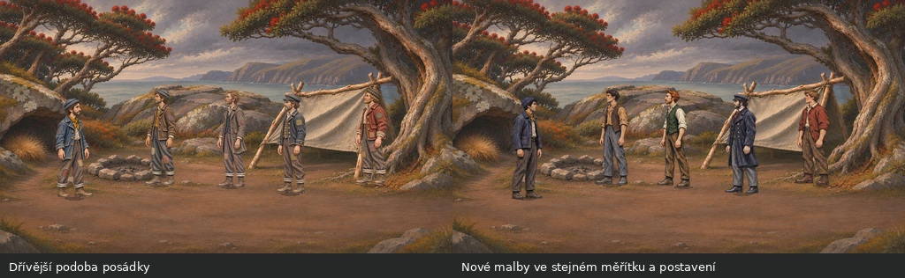

# Posádka v pohybu

Pět mužů používá 30 nových maleb kroku, pět stojících postojů, pět natažených paží a pět kleků pro práci u země. Raynal má na prvním břehu navíc sed na naplaveném dřevě. Věk postav vychází z historických podkladů. Tváře, oděvy, držení těla i samotný trámek jsou výtvarnou interpretací. [Posádka Graftonu](../data/crew.csv) · [Pět samostatných portrétů](PEOPLE_ART.md)

Alickovi zůstává čepice a okrový šátek při chůzi i při práci. Kapitána od něj v dálce odliší delší dvouřadý kabát a nízký štítek čepice. Světlé rukávy rámují Raynalovu zelenou vestu. Henry má okrové rukávy a tmavé kudrny. Nejmladšího George poznáme podle světlé hlavy, červeného kabátku a širších ramen. [Portréty vedle celých postav](reviews/portraits/posadka.webp)

| Postava | Původní list z ImageGen | Kroková kresba, výřezy a otisky |
|---|---|---|
| Alick McLaren | [Postoje](artwork/cast/player.png) | [Atlas](dist/assets/walk/player.png) · [Měření](dist/assets/walk/player.json) |
| François Raynal | [Postoje](artwork/cast/raynal.png) | [Atlas](dist/assets/walk/raynal.png) · [Měření](dist/assets/walk/raynal.json) |
| Thomas Musgrave | [Postoje](artwork/cast/musgrave.png) | [Atlas](dist/assets/walk/musgrave.png) · [Měření](dist/assets/walk/musgrave.json) |
| Henry Forgés | [Postoje](artwork/cast/henry.png) | [Atlas](dist/assets/walk/henry.png) · [Měření](dist/assets/walk/henry.json) |
| George Harris | [Postoje](artwork/cast/george.png) | [Atlas](dist/assets/walk/george.png) · [Měření](dist/assets/walk/george.json) |

Každý z pěti zdrojových listů vznikl jedinou generací. Prvních šest kreseb tvoří sled kroků, dolní dvě zleva postoj v klidu a podání ruky. Pro práci nízko nad zemí vznikl podle těchto postav další list. Na něm je vidět, kde má ruka uchopit nástroj a na které botě leží váha. Na prvním břehu může Raynal sledovat Alicka vsedě a rukou se opřít o kus dřeva. [Zadání a SHA-256 zdrojů](artwork/cast/manifest.json) · [Klečící pětice](artwork/cast/low-work.png) · [Raynalův sed](dist/assets/shore-rest/manifest.json)

## Usazení ve scéně

Krokový atlas má 1536 × 1024 px. Každé z šesti políček je čtverec o straně 512 px. Výřez uvnitř pole má 448 × 500 px, kotva podpory je na souřadnicích 256, 498. Při sestavení se celá kresba rovnoměrně zmenší či zvětší a posune. Zachovává se průhledný prostor mezi nohama a měkký okraj původních tahů. Střed horní části hlavy během šestice kreseb kolísá nejvýše o dva pixely, spodní hrana bot o jeden. Na přechodech mezi kresbami odpovídá posun zatížené podrážky vzdálenosti, kterou urazil trup. Při zastavení zůstane postava na svém místě. [Sled kroků v táboře](reviews/crew/gait-in-camp.webp) · [Řízení kroku](dist/animation.js)

Pracovní atlas má 1536 × 512 px. Ve všech třech polích se odměřuje úchop od bot. U prkna na člunu je výřez připnut přímo na dlaň, takže Alick může přidržet záď i příď. Musgrave stojí vedle šikmé podpěry. Při výměně má kladivo v druhé ruce. Úder se otáčí kolem dlaně a končí čelem kladiva na hřebu. Po uvolnění oba odstoupí a Alick vyzkouší spoj. Musgrave při kleku v člunu drží nástroj přibližně 0,365 své výšky dopředu a 0,108 výšky nad úrovní bot. [Otisky a souřadnice úchopů](dist/assets/work-poses/manifest.json) · [Šest okamžiků u prkna](reviews/crew/plank-contact.webp) · [Raynal v měřítku malé scény](reviews/crew/resting-on-shore.webp)

Porovnání tábora používá stejné pozadí i měřítko obou sestav. Náhled chůze přehrává herní políčka na malbě tábora, náhled břehu skládá malbu, Alicka a Raynalovo sedadlo. Šest pohledů na prkno vzniklo rasterizací skutečného SVG po jednotlivých hráčských pokynech. Tyto obrazové zkoušky vznikly bez prohlížeče. [Kontrola malovaných pixelů](tests/crew-painting.py) · [Zkoušky chůze a pracovních gest](tests/crew.test.cjs) · [Předání hřebů, úder a uvolnění obou rukou](tests/plank-company.test.cjs) · [Dřívější rozbor načítaného postoje u ohně](reviews/crew/README.md)

Původní práci a její právní režim zachycují [poznámky o právech](../RIGHTS.md).
