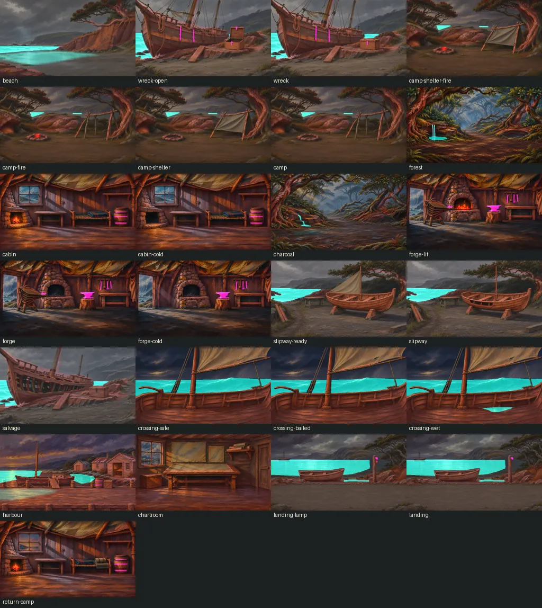

# Světlo na dřevě, kameni a vodě

Na vraku je mezi zádí a svahem vidět voda. Když Alick otevře bednu, její víko část průhledu zakryje. V jednom a témže bodě obrazu proto voda smí odrážet oblohu jen před otevřením. Podobně se při vybrání vody ze dna člunu objeví drsnější prkna, ale odlesky na moři za bortem pokračují. Oba příklady se ověřují přímo z hotových map.

V atlasu je 14 místností, 22 rozdílných maleb a 25 světelných stavů. K oběma podobám tábořiště přibyla varianta s ohněm, k přistání varianta se zavěšenou lampou. Při práci s holým ohništěm, osazenými měchy a rozpálenou výhní se mění skutečný podklad scény. Vyřešená plavba vždy používá mapu odpovídající obrazu opravené plachty a suchého člunu. Rekvizity, posádka a pracovní detaily, které hra kreslí samostatně nad malbou, mají vlastní kresbu a hloubkové pořadí.

[Polygony podle místností](rooms.json) · [Varianty, světelné zdroje a paprsky](variants.json) · [Otisky obrazů a dat](../../dist/assets/materials/manifest.json)



## Jak vznikají mapy

1. Výpočet se dotáže stejného registru maleb, ze kterého vybírá pozadí hra. Souřadnice začínají v levém horním rohu a vztahují se na celý obraz 16:9. Každá malba se přepočte přímo na 256 × 144, stejně jako při roztažení podkladu ve hře. Geometrie pobřeží, potoků a vody v člunu přebírá také obrysy a výřezy z modulu krajiny. Uzly na dřevě, obrys kovadliny, skla mezi okenními příčkami, sukno na kavalci, polohu výhně a další plochy určují ruční registrace. Přechod přes hranu kontury používá devět plošných vzorků uspořádaných 3 × 3. Materiál a osvětlení se vyhodnotí až po jejich sloučení. [Výběr podkladů](../../dist/voyage-world.js) · [Obrysy vody](../../dist/landscape.js)
2. Materiálové třídy určují drsnost, příspěvek kovu, schopnost vracet rozptýlené světlo a přibližnou výšku povrchu. Sklon drobných detailů vychází z vyhlazených jasových změn v konkrétní malbě. Dřevo a kámen mají samostatnou výšku reliéfu. Pole oblohy zůstává ploché. Mokrá prkna a mokrý písek na okrajích postupně přecházejí do suchého povrchu.
3. Projekční výškové pole umožňuje odhadnout zastínění. Směr denního světla je určen pro každou místnost. Okenní otvor, oheň v chatě, uhlí ve výhni a svítilna u přistání mají vlastní polohu a barevnost. Mezi přijímačem a místním zdrojem se na šesti místech porovná výška překážky s výškou paprsku. Přímo vyzařující plamen v malbě lze poznat jen v malé oblasti kolem skutečného ohně.
4. Rozptýlené světlo se přenáší dvakrát mezi okolními povrchy. Jeden přenos sbírá příspěvky z osmi směrů ve třech vzdálenostech (3,5, 12 a 29 texelů). Příspěvek závisí na odrazivosti, barvě materiálu, vzájemné výšce, vzdálenosti a průchodnosti úsečky. Druhý přenos používá světlo přijaté v prvním. Obruba výhně tak může vracet teplé světlo, i když sama nezáří. Hodnoty jsou výtvarným odhadem nad plochou malbou. Zakrytou část objektu a prostor mimo záběr z ní rekonstruovat nelze.

[Reprodukovatelný výpočet](../../tools/bake_materials.py) · [Kontrolovaný test přenosu a překážky](../../tests/material-bake-transport.py)

## Rozhraní pro zobrazení

Klasický skript vystaví `window.CastawayMaterialAtlas.get(sceneId, flags)` a podporuje také CommonJS. Výsledkem je vždy stejný objekt pro stejnou kombinaci obrazu a světla. Obsahuje `key`, cestu k pozadí v `plate`, rozměry `width` a `height` a tři datové adresy PNG. Pro neznámou místnost vrátí `null`. Adresy jsou součástí skriptu i při spuštění přes `file://`. Shodné PNG se v balíku ukládá jen jednou.

| Mapa | R | G | B | A |
|---|---|---|---|---|
| `surface` | Normála směrem doprava | Normála směrem nahoru | Výška, kód 128 mimo reliéf dřeva a kamene | Drsnost |
| `medium` | Podíl kovu | Síla rovinného odrazu na vodorovném mokrém povrchu | Nezakrytá část okolí, 255 znamená otevřeno | Místní zdroj světla |
| `light` | Červená složka | Zelená složka | Modrá složka | Měkká maska paprsků ve vzduchu |

Normála míří kladnou osou Z k pozorovateli. Normála bez náklonu má R i G rovné 128. Všechny kanály kromě RGB mapy `light` jsou lineární data. RGB této mapy nese ambientní a nepřímé osvětlení po přenosové funkci sRGB. Neutrální obloha má hodnotu 128, přibližně 0,214 po převodu do lineárního prostoru. Nulová alfa nechává ostatní tři datové kanály platné. Při dekódování PNG se proto musí zachovat RGB bez násobení alfou a bez barevné konverze.

## Ověření

| Bod v % zleva a shora | Měřená změna (8 bitů) |
|---|---|
| Plavba, 68 / 81 | Síla rovinného odrazu je 220 před vybráním vody a 0 po něm. Za člunem v bodě 15 / 46 zůstává 220. |
| Vrak, 73 / 45 | Voda v průhledu dává 220. Po otevření bedny má víko ve stejném bodě odraz 0 a výšku dřeva 166. |
| Chata, 18 / 21 a 21,7 / 21 | Sklo má drsnost 44 a výšku 128. Příčka má drsnost 172 a výšku 156. |
| Výheň, 41 / 43 | Podíl emise vzroste z 0 na 186. Vedle ústí v bodě 41 / 51 zůstává emise nulová, odražené světlo však přejde z RGB (114, 112, 112) na (198, 126, 112). |
| Pláž, 22 / 21 | V obloze má normála hodnotu (128, 128), maska odrazu i lokální emise jsou nulové. Světlo má RGB (128, 128, 128). |

Test Node dekóduje uložené PNG nezávisle na generátoru, ověří otisky všech 72 map a maleb a projde kombinace příznaků ve 14 místnostech. Výpočetní test navíc osvětlí barevnou plochu vedle neutrálního povrchu. Měří přenos za dosahem jednoho skoku a jeho zeslabení po vložení prostorové překážky.

Z adresáře `adventure` spusťte následující příkazy. Výpočet využívá Node, Python, NumPy, SciPy a Pillow. Pro běh vydané hry jsou mapy již součástí atlasu. Výchozí výstup byl ověřen s NumPy 2.3.5, SciPy 1.17.0 a Pillow 13.0.0.

```sh
OPENBLAS_NUM_THREADS=1 python tools/bake_materials.py
OPENBLAS_NUM_THREADS=1 python tests/material-bake-transport.py
node --test tests/material-bake.test.cjs
```

[Test registrací](../../tests/material-bake.test.cjs) · [Přenosný atlas](../../dist/material-atlas.js)
