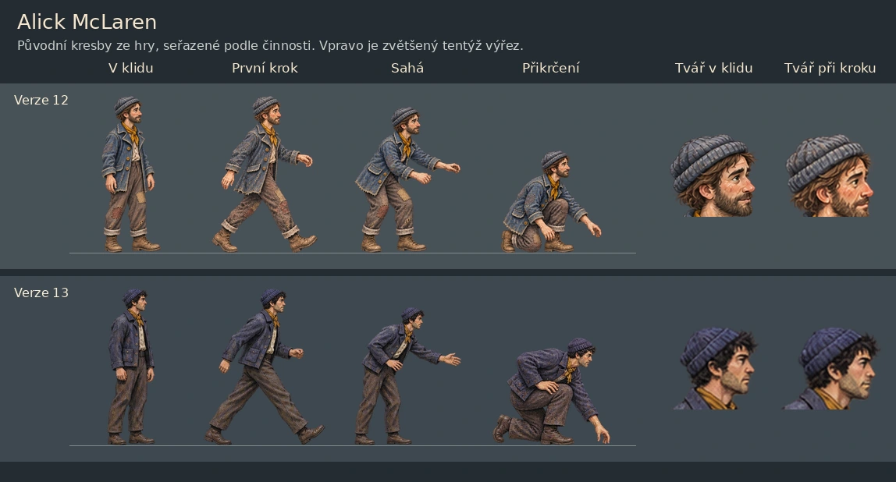
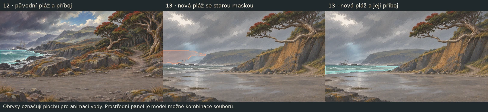

# Když se obraz a ovládání rozejdou

Revize hry *Until We Return*, 18. listopadu 2026. Hráč na první pláži hlásí proměnu Alickovy tváře, příboj mimo vodu a klikání vedle předmětů. Dodal také obraz rozehrané druhé kapitoly, **Inside Epigwaitt**. V chýši jsou vidět prvky staršího vydání. V aktuální hře jsme samostatně reprodukovali dvě chyby při načítání obrázků. Jedna oddělí kulisu od aktivních předmětů a druhá po jediném výpadku nahradí další chůzi skokem.

**Ruční průchod v připojeném prohlížeči se zastavil před hrou. Počet osobně dohraných kapitol při této kontrole je 0 ze 7.** Komentář předal snímek a popis vybraného prvku. Nástroj pro ovládání nabídl oddělené okno s přihlášením. Spravovaný náhled téhož sestavení se také nespustil. Níže uvádíme u každého nálezu, jak vznikl. Dvě ilustrace jsou složené z vydaných herních souborů. Poslední tabulka zachycuje zbývající práci přímo ve hře.

## Co prozradila chýše

| Č. | Co je vidět nebo co lze zopakovat | Dopad na hráče |
| --- | --- | --- |
| 1 | Na snímku má Alick vousy, okrový šátek, záplatu na koleni a vysoké boty s ohrnutým lemem. Tyto znaky má kresba z vydání 12. Ve vydání 13 má jemné strniště, tmavší kabát a nohavice přes boty. Také označení scény v komentáři obsahuje `··· › Inside Epigwaitt`. Tři prostřední tečky vytvářela stará značka rozhovoru. | V rozehrané chýši zůstala starší podoba hlavního hrdiny. K určení okamžiku, kdy během hry změní tvář, chybí dvě po sobě zachycené fáze stejné akce. |
| 2 | Světlý ovál nádoby na hráčově snímku má střed přibližně na 54,7 % šířky a 64,8 % výšky herního obrazu. Starší kresba nádoby má střed hladiny v bodě (54,66 %, 64,79 %). Nová malovaná nádoba jej má v (50,39 %, 73,60 %) a leží níže na podlaze. Měřeno od levého horního rohu scény, bez horní lišty a inventáře. | Shodují se tvar, místo a vzhled postavy. Samotný záběr nedatuje ostatní soubory načtené v této kartě. |
| 3 | Nádoba a padající kapka jsou součástí širokého pohledu na chýši. Hra v celkovém pohledu přijímá povel k ohledání střechy kolem bodu (53,7 %, 17,7 %). Přímo na mísu v tomto pohledu žádnou akci neváže. Teprve v detailu střechy je dostupné **Watch the tin pan** a lze si poslechnout dopad kapky. Ověřeno v definici obou pohledů ve verzi 13. | Přirozený první krok při řešení hádanky nikam nevede. Kliknutí na nádobu by mělo otevřít stejný detail jako kliknutí na netěsnost. |
| 4 | V chýši se jméno **Inside Epigwaitt** ve výchozím stavu opakuje těsně nad sebou, jednou v levém rohu malby a podruhé na liště vedle Alickova jména. To je na dodaném snímku přímo čitelné. | Druhé jméno místa zabírá pozici, kde se při najetí na předmět objevuje jeho název. Po odjetí myší se oba řádky vracejí ke stejnému textu. |

Všechny čtyři zobrazené pohyby patří hernímu Alickovi. V rámci verze 13 sdílí první krok a klid stejnou čapku, profil nosu i krátké vousy. Rozhovor používá samostatně namalovaný čelní portrét. V příběhu hraje hráč za Alicka od první do páté kapitoly. Teprve v šesté přebírá záchranu kapitán Musgrave. [Portrét z rozhovoru](../../dist/assets/cast-portraits/player.webp) · [Obsazení jednotlivých kapitol](../../dist/voyage-stories.js) · [Nádoba v místnosti a v detailu](../../dist/fieldwork-ui.js) · [Pravidla hádanky](../../dist/fieldwork.js)



## Když se nepodaří načíst malbu nebo krok

**5. Předměty vraku nad obrazem pláže.** V testu jsme nechali načíst běžný začátek hry a vyvolali obvyklý odchod z pláže k vraku. Pouze požadavek na obraz vraku vždy skončil chybou. Uložená místnost se změnila na `wreck`. Objevily se ovládací prvky páčidla, truhly, kapitána a lana. Vlastnost pozadí stále ukazovala na `assets/tidepaint/beach.webp`. Obsluha odchodu po skončení čekání nezkontroluje, zda se obraz podařilo načíst. Stejnou větev po čekání má i přechod kapitoly. Praktická reprodukce zde pokrývá odchod k vraku. [Obsluha odchodu a výběr obrazu](../../dist/app.js) · [Spustitelná reprodukce](nacteni.cjs)

**6. Jedna ztracená kresba vypne další kroky.** Ve druhé zkoušce selhal jen první požadavek na Alickův obrázek chůze. Další požadavky by uspěly. Hráč přitom měl běžný pohyb zapnutý. Při dvou po sobě jdoucích kliknutích na zem postava pokaždé změnila souřadnici rovnou na cílovou a o obrázek si znovu neřekla. Kontrolní běh s úspěšným načtením zaznamenal při stejných dvou kliknutích pokaždé 179 různých vodorovných poloh v prvních 180 krocích testovacích hodin. Po výpadku byla pokaždé jen jedna. To vysvětluje jeden způsob, jak vyvolat skok. Blikání ani vzhled v jednotlivých okamžicích tento test nezachytí. [Spustitelná reprodukce obou průchodů](nacteni.cjs)

Zkoušky 5 a 6 spouštějí herní obsluhu kliknutí ve stávající testovací náhradě DOM. Stejný výsledek daly zdrojové soubory i distribuovaná verze 13 s obrázky WebP. Na distribuovaných souborech prošel také běžný automatický scénář sedmi kapitol včetně záchrany. Ten zadává povely bez myši a nevykresluje obraz. Chybu obrázku v nich vyvoláváme záměrně. Hráčův záznam přenosů k dispozici nemáme. Opravu má smysl ověřit nejprve při úmyslně přerušeném načítání. Při výpadku má zůstat pohromadě současná malba, počasí, aktivní předměty i uložené místo. Obnovení přenosu má umožnit přechod a běžnou chůzi. [Jak fungují testovací hodiny a kliknutí](../../tests/ui-contract.cjs)

## Kde leží voda a předměty na první pláži

**7. Vydání 12 a 13 používají stejné adresy pro různé soubory.** Týká se to malby pláže, kresby chůze i kódu určujícího polohu příboje a předmětů. Například obsah `assets/tidepaint/beach.webp` začíná v SHA-256 na `37e65b27f4f7` ve vydání 12 a na `0663e6fa24be` ve vydání 13. U levého okraje pláže, v 5 % její šířky, začíná hlavní pás příboje ve výšce 42,76 % na staré malbě a 60,10 % na nové. Při herním obrazu 1360 × 765 px je rozdíl **133 px**. Prostřední panel ukazuje, kudy by šla pěna, kdyby novou malbu doprovázela stará animace. Skutečné složení souborů na hráčově úvodní pláži zůstává otevřené. [Oblast vody v novém vydání](../../dist/landscape.js) · [Jak sestavení pojmenovává soubory](../../tools/build_web.py)



Změnila se také poloha předmětů. Tabulka udává středy jejich aktivních ploch v procentech šířky a výšky scény. K určení závady při kliknutí potřebujeme mít v jednom záběru kresbu, skutečné místo kliknutí a odpověď hry. [Rozmístění a přístup postav](../../dist/stage-direction.js)

| Předmět | Verze 12, x / y | Verze 13, x / y |
| --- | ---: | ---: |
| Lano na pláži | 33,9 / 67,8 | 34,0 / 71,6 |
| Tyč na pláži | 48,0 / 71,9 | 48,4 / 75,4 |
| Cíp plachty | 69,0 / 33,4 | 70,1 / 37,6 |
| Naplavené dřevo | 25,5 / 71,0 | 25,5 / 73,5 |
| Páčidlo u vraku | 49,3 / 69,5 | 53,0 / 77,5 |

Pro soubory, které patří k sobě, navrhujeme společné číslo vydání v cestě nebo názvy s otiskem obsahu. Hráč s rozdělanou hádankou má mít možnost dokončit tah ve stejném vydání. Číslo verze v nastavení by při dalším hlášení pomohlo rozlišit otevřenou kartu a nově načtenou hru.

## Co ještě projít vlastní rukou

Začít v chýši v hráčově stávající pozici. Pro začátek kampaně použít samostatnou testovací relaci s vlastním uložením. U každého rozdílu zaznamenat název místnosti, rozměry herního obrazu, viditelný předmět, místo kliknutí a výsledek. U potíží s pohybem pořídit také krátkou sekvenci od postoje před kliknutím až po zastavení.

| Kapitola a místa | Jak poznat výsledek při hraní |
| --- | --- |
| I · The Shore, The Wreck, Under the Trees | Nechat přejít několik vln. Sledovat hranu pěny proti obloze i skalám. Jednou oslovit Raynala, dojít pro lano a tyč, zachytit plachtu. Vyzkoušet páčidlo i truhlu. Porovnat Alickovu tvář v klidu, prvním kroku, při obratu, v podřepu a v rozhovoru. |
| II · Inside Epigwaitt, The Winter Stream | Zkusit nejprve přímo nádobu a poté střechu, sledovat jednu kapku až k dopadu, opravit šev a vrátit se od potoka. Ověřit, že Henry po práci vstane a oběma mužům zůstávají chodidla na stejné úrovni podlahy jako nábytek. |
| III · The Forge, Charcoal and Salvage | Pohledem sledovat ruku, horní desku měchu, usazení hubice a reakci uhlí. Zkusit neúčinný vrták, vrátit se k výhni a při každé změně zkontrolovat Raynalovu polohu. |
| IV · The Boat on the Shore, The Last Useful Pieces | Obejít člun, společně usadit prkno, přerušit práci a vrátit se. Sledovat oba úchopy až po uvolnění rukou a ověřit, že dokončené prkno zůstalo v trupu. |
| V · An Open Boat | Nechat přejít přeháňku, nabrat vodu ze dna, opravit plachtu. Ověřit pěnu vůči okraji člunu, pevné úchyty lana, počet lidí na palubě a rozdíl mezi počasím a následkem opravy. |
| VI · Stewart Island Harbour, Invercargill Chart Room | Převzít roli Musgravea. Zkontrolovat jméno v liště, chodící postavu i portrét při prvním rozhovoru a návratu s mapou na molo. |
| VII · Back in Carnley Harbour, The Two Who Waited | Promluvit s oběma čekajícími muži, předat zásoby, doprovodit je zpět k člunu. Ověřit, kdo je přítomen na břehu, kdo nastoupil, anglické závěrečné repliky a otevření archivu. |

## Jak výsledky zopakovat

Referencí jsou dva veřejné commity. Novější změny v dokumentaci mohou mít vyšší číslo commitu než posuzovaná hra. Obrázkové skripty načítají oba původní stavy z historie Git. Skript pro načítání zkouší herní soubory v aktuálním pracovním stromu a očekává popsané chování verze 13. Potřebuje Node.js, obrazová porovnání navíc Python s Pillow. [Vydání 12](https://github.com/OnFiala/auckland-castaways/commit/c2eff1a5f8dd803dccd28d50db0ab66b27949d6e) · [Vydání 13](https://github.com/OnFiala/auckland-castaways/commit/4dbfa437c2d04a89102ac06a5813d0e377ccbb80) · [Kreslení oblasti příboje](registrace.py) · [Sestavení srovnání postavy](postava.py)

```sh
node adventure/reviews/browser-13/nacteni.cjs
python adventure/reviews/browser-13/registrace.py
python adventure/reviews/browser-13/postava.py
```
