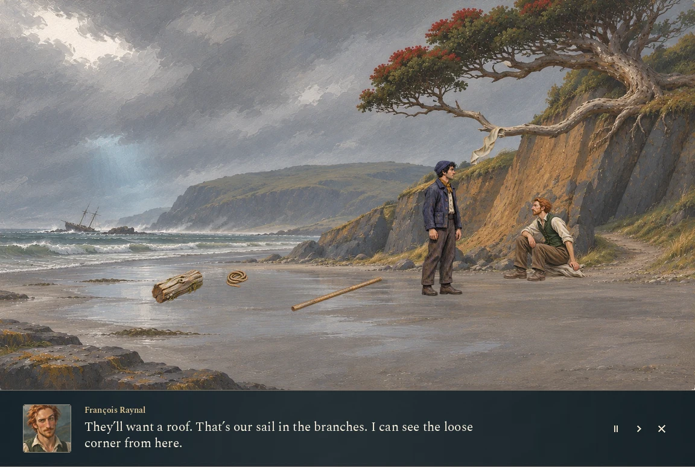
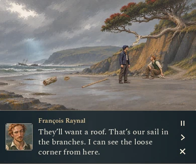
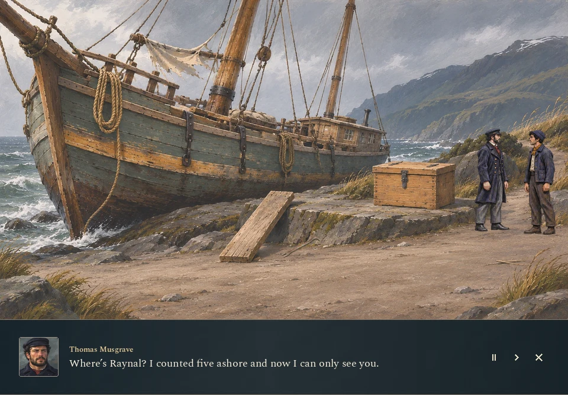
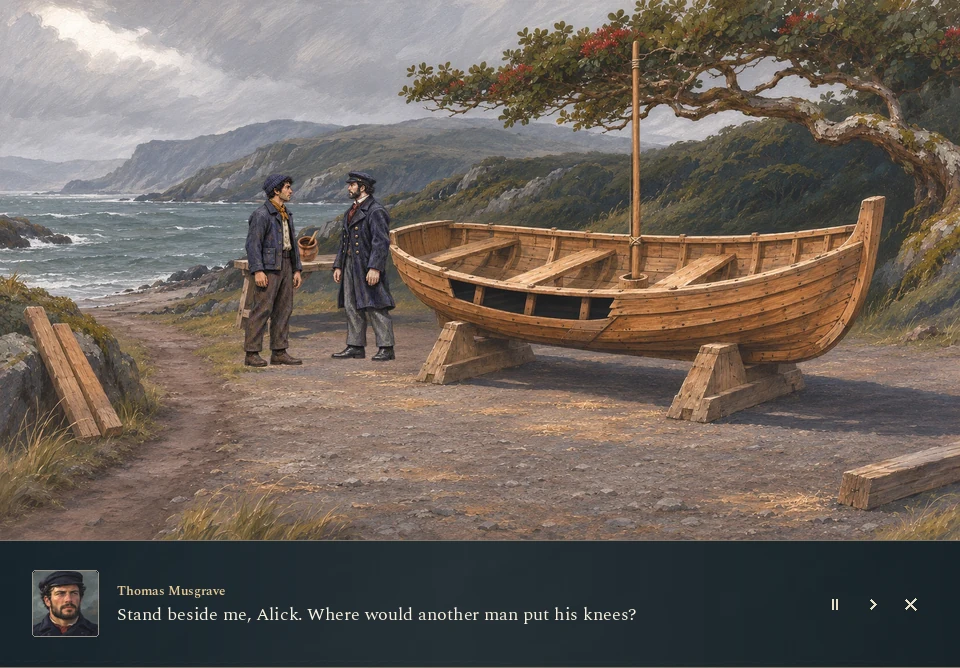

# Setkání na pobřeží

Raynal sedí zády ke svahu. Alick stojí o kus níž na mokrém písku, na doslech a čelem k němu. Nad nimi visí roh plachty, kterého si Raynal v rozhovoru všimne. Třetí větu jejich skutečné úvodní výměny jsme ponechali na obou velikostech obrazu, aby bylo možné porovnat i její sazbu.

| Šířka jeviště | Viditelná výška sedícího Raynala¹ | Portrét | Písmo repliky | Řádky repliky v montáži |
|---:|---:|---:|---:|---:|
| 1152 px | přibližně 141 px | 78 px | 21 px | 2 |
| 390 px | přibližně 48 px | 52 px | 16 px | 3 |

¹ Včetně krátkého kusu dřeva. Herní měřítko sedící figury je 63,5 % běžné výšky v dané hloubce. Referenční bod jeho přední boty leží na 77,8 % šířky a 72,1 % výšky scény. Alick začíná na 63,6 % šířky a 75,7 % výšky scény. Na obou šířkách je mezi nimi vidět pruh země. Na telefonu čteme výraz především ze čtvercového portrétu. Sed poznáme i v samotném výjevu podle vedení stehen a předklonu hlavy.

## U vraku

Alick při oslovení přichází ke kapitánovi zprava. Truhla, její kování i obě postavy se vejdou vedle sebe. Pravou botu Alicka od rámu dělí zhruba dvacet pixelů. Kapitán se otočil k němu a má volnou tvář.

## U rozestavěného člunu

Při oslovení z příchozí cesty zůstávají oba muži vlevo od člunu. Kapitánova otázka o místě pro kolena tak má v obraze konkrétní odpověď. Hráč za ním vidí otevřený vnitřek se sedáky i dvě podpěry.

## Čapka a cíp plachty

Na telefonu zůstává mezi obrysem Alickovy hlavy a cípem plachty **9 px**. V široké kompozici se odstup zvětší na **25 px**. Světlou látku tak lze v obou velikostech sledovat od konce až k větvi. Měření bere horní pětinu Alickovy postavy a počítá nejkratší vzdálenost středů pixelů obou obrázků při krytí aspoň 128 z 255.

## Jak byla kontrola provedena

Jde o **rastrové montáže z vydávaných souborů hry**. Skript načítá skutečný stav scén, herní repliky, stanoviště, perspektivu, rozměry atlasů, pracovní postoje, obrázky předmětů a oba řezy písma Spectral. U druhých dvou scén používá pravidlo příchodu k partnerovi z herní funkce pro oslovení. Pod výjev přidává rekonstrukci rozhovorového pásu. Anglické repliky ponechává tak, jak jsou ve hře.

Kompozice zobrazují nehybné postavy po příchodu. Horní hlavička, ukazatel, pohyblivé počasí, světelné filtry a měkké stíny CSS v náhledech chybějí. Náhledy nevznikly snímáním obrazovky. Zalomování počítá Pillow na základě skutečných šířek znaků, takže prohlížeč může zvolit jiný konec řádku.

Příkaz `python adventure/reviews/company/montaz.py` sestaví všechny čtyři náhledy pomocí Node a Pillow. Kontroluje odstup a orientaci prvního setkání, rozměry sedící figury i to, že se vypočítané řádky vejdou do vyhrazeného prostoru. V měření jsou také kontrolní součty podkladových obrazů. [Skript](montaz.py) · [Měření](mereni.json)
