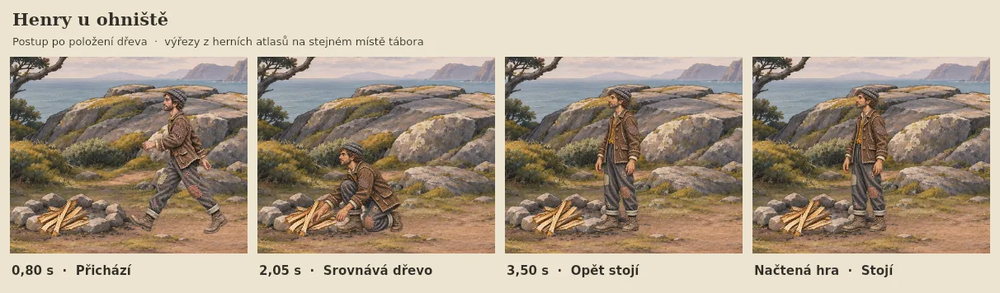

# Henry u ohniště

Při prohlídce dřívější verze v Chromium zůstal Henry po načtení rozehraného tábora klečet u dřeva. I po dalších 2,1 sekundy zobrazovala hra výřez `1341 303 499 487`, tedy Henryho klečící postavu. Uložení uchovávalo správnou informaci o dřevě v ohništi. Chyba byla v kreslení postavy. Hra si při každém snímku vyložila přinesené dřevo jako pokyn ke kleku.

Obrázek vznikl složením malby tábora, palivového dřeva a skutečných herních atlasů. Poloha, orientace, velikost a postoj pocházejí z běhu modulu pohybu po 25 ms. Hodiny začínají položením dřeva v táboře s hotovým přístřeškem. Henry dojde k ohništi v čase 1,375 s, poklekne v čase 1,575 s a od 2,550 s opět stojí. V posledním políčku začíná nový běh s týmž stavem ohniště. Tato obrazová zkouška sleduje Henryho. Vynechává ostatní osoby, počasí, rozhraní a vykreslování v prohlížeči. [Pohyb postav](../../dist/choreography.js) · [Stanoviště](../../dist/stage-direction.js) · [Zdrojové listy a měření postojů](../../dist/assets/work-poses/manifest.json)

Při oslovení cestou se Henry zastaví na místě a obrátí se k Alickovi. Po rozhovoru může dojít k ohništi. Pokud jej Alick osloví přímo při rovnání dřeva, Henry vstane a vykonaný pohyb už neopakuje. Při omezeném pohybu se zobrazí rovnou hotové stanoviště. Musgrave má při přeplavbě místo u vody v trupu, Raynal u kormidla. Šest zkoušek sleduje postavy a skutečné výřezy jejich atlasů, další prochází položením dřeva a opětovným načtením hry přes obsluhu herního rozhraní. [Zkoušky postav](../../tests/crew.test.cjs) · [Zkoušky rozhraní](../../tests/voyage-ui.cjs)
