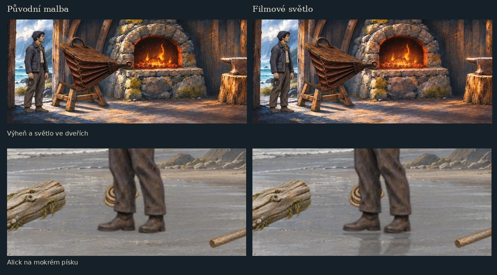

# Until We Return · Světlo v malovaných scénách

Na pobřeží může Alick přejít z tmavé suché hlíny na stříbrný mokrý písek. Pod botami se objeví krátký odraz, který kopíruje jeho krok. Po návratu na suchou zem zmizí. V Epigwaittu přichází chladné světlo z okenní tabulky. Po zatopení se k němu přidá teplo u krbu. V kovárně dál dopadá denní světlo otevřenými dveřmi, i když se výheň rozehřeje. Na přeplavbě vybírání vody mění malbu podlážek i jejich schopnost odrážet postavu.

V nabídce **Settings → Scene lighting** je výchozí **Automatic**. Na menší obrazovce nebo zařízení s omezenou pamětí volí úspornější výpočet. Na větší obrazovce jej zvolí také při trvale pomalém vykreslování. **Cinematic** zapne plný světelný průchod, **Balanced** prostorové vyhlazení a **Original painting** vrátí dosavadní malbu. Přepnout lze i v rozehrané hře. Při omezení pohybu se ustálí počasí, světlo i jeho vzorkování. [Anglický návod](../../PLAY.txt)

## Co vzniklo pro tuto hru

| Technika | Jak se projevuje ve hře |
|---|---|
| Normály, reliéf a materiály | Každé místo má mapu normál, výšky a drsnosti. Referenční vzorek původní barvy pomáhá zachovat kontrast štětce. Kov, voda, mokré dřevo a suché plátno mají různé odlesky. Šikmý světelný paprsek používá výškovou mapu k drobnému posunu vzorku reliéfu. Souřadnice postavy, tahy malby a místa pro kliknutí zůstávají společné. |
| Pečené nepřímé světlo | Při sestavení se světlo dvakrát rozptýlí mezi okolními plochami. Výpočet používá barvu originálu a překážky zakreslené v obraze. Barva odražená v kabině se liší od světla pod širým nebem. |
| Expozice, rozptyl a optika | Přímé světlo, odrazy a žár se počítají v lineárním prostoru s jasem i nad úrovní zobrazitelné bílé. Převod na běžný displej zachová kresbu ve světlých místech. K drobnému rozkvětu světla dochází v okolí skutečného zdroje, například výhně. Přísvit ve vzduchu je vázaný na průhledy a okna. Mírný pokles jasu k okraji patří jednotlivé scéně. |
| Živé rovinné odrazy | Písek, mokrá prkna mola a voda uvnitř člunu mají vlastní obrys. Podle polohy chodidla se na povrch promítá aktuální krok nebo pracovní póza. Na molu se navíc odráží namalovaný vyvazovací sloup. |
| Vyhlazování | Při pohybu režim Cinematic skládá čtyři postupně posunuté vzorky. Na malém cíli počítá v plném rozlišení (TAA), u většího obrazu současně dopočítává cílové rozlišení (TAAU). Vyšší jas v nové scéně ani předchozí postava se nepřenášejí do nové malby. Režim Balanced a ustálený obraz používají FXAA. U obrysu mokré plochy se na podporovaném zařízení samostatně použije až čtyřnásobné MSAA. |
| Předměty a pracovní detaily | Světlo na člověku a předmětu vychází ze stejného směru jako v okolní malbě. Osm pracovních detailů má vlastní jemná zvýraznění, například na železu vrtáku, mokrém švu či mosazi kružidla. Ovládání a písmo mají vlastní vrstvu. |

Malby zůstávají dvourozměrné. Výsledkem je osvětlení malovaného reliéfu, s pevnou kamerou a výstupem pro displeje SDR. Na přístroji bez WebGL 2 hra použije statickou světelnou mapu a stále dovoluje odehrát všechny kapitoly. [Původ map a kontrolní body](../../artwork/materials/README.md) · [Registrace materiálů](../../artwork/materials/registrace.webp) · [Výpočet odrazů a světla](../../dist/material-renderer.js) · [Referenční model materiálů Filament](https://google.github.io/filament/Filament.html) · [Materiály Epic k časovému vyhlazování](https://forums.unrealengine.com/t/west-coast-dev-tour-and-other-publications-posted-to-resources/9658)

## Co ukázal průchod v prohlížeči

Chromium otevřelo rozbalené vydání bez přístupu k síti. V téže pozici na pobřeží, v chatě, u výhně a před i po vybrání vody z člunu pořídilo dvojici snímků. Ve všech pěti dvojicích zůstaly hráčova postava i cíle pro kliknutí na stejných souřadnicích. Po ustálení obrazu při zapnutém omezení pohybu se každý opakovaný snímek shodoval po pixelech. Ve stínech chaty i kovárny se medián jasu vůči originálu změnil o jediný stupeň z 255. [Úplná obrazová galerie](https://github.com/OnFiala/auckland-castaways/releases/download/game-v16/lighting-study.webp) · [Záznam měření v Chromiu](https://github.com/OnFiala/auckland-castaways/actions/runs/44516067022/job/135533158753)

Při kliknutí na volný mokrý písek došel Alick na stejné místo v obou režimech. Pod jeho botami se v průměru změnilo RGB o 19,8 stupně z 255. Obrys mokré plochy použil čtyřnásobné MSAA. Hra reagovala také při vynucené ztrátě grafického kontextu. Hráč mohl zvednout lano a po návratu WebGL se scéna znovu rozsvítila. Samostatný dotykový průchod zvedl lano na emulovaném telefonu o rozměru 390 × 844. Měření proběhlo se softwarovým grafickým ovladačem SwiftShader. Rychlost na fyzických telefonech bude záviset na jejich GPU. [Ověřená verze zdrojů](https://github.com/OnFiala/auckland-castaways/commit/cba9a2c2611f9ae2c2d1594f99d77bdd71d76efe)

Při ručním hraní v samostatném Chromu na první pláži Alick skutečně došel k namalovanému lanu, sebral tyč a smyčkou stáhl plachtu z větve. U vraku si brašna podržela plátno i nástroj. Alick přešel ke kladce a po práci se znovu postavil. Tento prohlížeč v nastavení ohlásil statickou světelnou mapu. Obrazové dvojice nahoře pocházejí z průchodu se zapnutým WebGL. [Snímek z ručního průchodu u vraku](vrak-rucni-pruchod.jpg)

## Prohlédnout a hrát

Offline ZIP má 33 498 454 bajtů. Jeho SHA-256 je `c8ad003005839986d57262d787d1a03b5074a2391e7f5354347de9d3bce1827b`.

[Stáhnout vydání 16](https://github.com/OnFiala/auckland-castaways/releases/tag/game-v16) · [Porovnání obrazů z hraní](https://github.com/OnFiala/auckland-castaways/releases/download/game-v16/lighting-study.webp) · [Ověření celé hry](../../FULL_GAME_TESTING.md)
