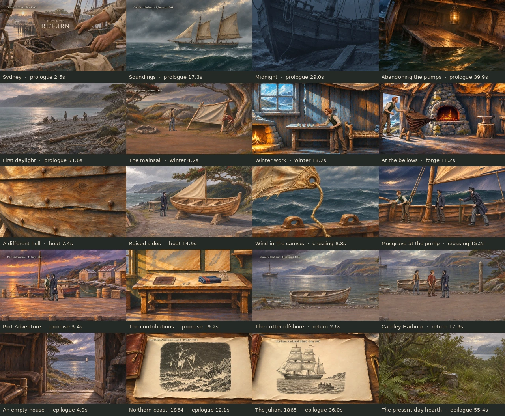

# Until We Return · Od vyplutí až ke krbu

Na přístavním molu v Sydney se do bedny ukládá pánev na hledání cínu. O několik týdnů později už stejnému mužstvu nepomůže ani kotevní řetěz. Když hladina v kajutě dosáhne stolu, obraz přejde na kameny ve svítání. Vyprávění v tu chvíli předá Alicka hráči. Raynal se ho na první pláži zeptá na George. Na větvi nad nimi visí plachta, ze které by šla udělat střecha.

Vydání 17 propojilo všech sedm hratelných kapitol osmi filmovými částmi. Úvod trvá 1 minutu 6 sekund. Celý anglicky namluvený film má 4 minuty 8 sekund včetně závěrečného návratu ke kamenům v Carnley Harbour. Lze jej přehrát i samostatně s anglickými titulky a výběrem kapitol. [Hra pro hraní offline](https://github.com/OnFiala/auckland-castaways/releases/download/game-v17/until-we-return-edition-17.zip) · [Samostatný film v MP4](https://github.com/OnFiala/auckland-castaways/releases/download/game-v17/until-we-return-story-film.mp4) · [Obrazová ukázka](https://github.com/OnFiala/auckland-castaways/releases/download/game-v17/filmstrip.webp)

[Jen úvodní film *Soundings* v MP4, 66 sekund](https://raw.githubusercontent.com/OnFiala/auckland-castaways/13bf293aea3ea2a6f13898d0dd01a4e41f3e6ec8/adventure/dist/assets/story-film/prologue.mp4)

## První spuštění a návrat do rozehrané hry

Na titulním obraze otevře **Watch film** film se zvukem. **Play adventure** přejde rovnou na břeh a **Read stills** nechá hráče projít malby vlastním tempem. Film má pauzu, samostatné ovládání zvuku a titulků i možnost přeskočit ho. Na dotykové obrazovce slouží stejné ovládací prvky.

Rozehraná hra se otevře v uložené kapitole. Kompas **Our journey** zpřístupňuje prolog *Soundings* a každou další dosaženou část pomocí **View film**. Po záchraně se v deníku zpřístupní **Watch the whole story**. Nastavení **Chapter films** určuje, jak se mají vyprávěné přechody chovat při dalším hraní. Hlas filmového vypravěče je součástí souborů hry. Volba hlasitého čtení dialogů během hraní dál používá hlas zařízení. [Anglický návod](../../PLAY.txt)

## Kde film předá práci hráči

| Začátek ve filmu | Část | Na co naváže hra |
| --- | --- | --- |
| 0:00 | *Soundings* | Od neúspěšné výpravy pro cín ke ztroskotání. Na břehu hledáte plachtu, suché třísky a způsob, jak dát o sobě vědět. |
| 1:06 | *Two squares of glass* | Dvě tabulky z kajuty dál slouží v Epigwaittu. V zimním domě vás ke skutečné netěsnosti zavede voda kapající ze střechy. |
| 1:27 | *The hole for a bolt* | V kovárně leží znovu využitý železný balast. U rozžhaveného ohně přebíráte práci na nástrojích pro zamýšlenou loď. |
| 1:47 | *What the dinghy could carry* | Neúspěšný vrták změní plán. Zbývá opravit a zvýšit boky malého člunu, do něhož se všech pět mužů nevejde. |
| 2:07 | *A hand for the pump* | Musgrave se ve člunu drží lana a pumpuje. Přesunete se k plachtě, vodě mezi podlážkami a hlídání pevniny. |
| 2:28 | *The wet streets* | Po pěti dnech je útočiště na Stewartově ostrově. V Invercargillu už Musgrave musí získat pomoc pro cestu zpět. |
| 2:50 | *Within sight of the house* | Při návratu se dům konečně vynoří zpoza výběžku. Poslední přistání i setkání s Henrym a Georgem prožijete ve hře. |
| 3:09 | *A letter from Callao* | Po záchraně se otevře samostatné svědectví z *Invercauldu*. Nakonec se podíváme na místo, kde stával krb v Epigwaittu. |

Na sever ostrova vstupujeme prostřednictvím dopisů. Obě posádky se během pobytu nepotkaly. Jména a řada drobných věcí mají oporu v dobových pramenech, včetně výšky vody u stolu, vyřezávaných šachů, neúspěšného vrtáku a pomoci v Invercargillu. Polohy rukou, konkrétní pohledy kamery a hudební motivy jsou současnou inscenací. [Prameny k jednotlivým záběrům](../../artwork/story-film/HISTORY.md) · [Anglický scénář](../../dist/story-film-script.js)

## Obraz a zvuk

Pět nových maleb doplňuje obrazy z hratelných místností. Animace od sebe odděluje vodu, plachtoví, světlo zavěšené lampy, měchy a papír s ilustracemi. Lokalitu a datum uvádějí krátké nápisy v obraze. Vyprávění má vlastní anglický syntetický hlas. Hudba, příboj, plátno, pumpa i kov vznikly pro hru. Offline balíček obsahuje obraz i zvuk ve formátech MP4 a WebM, anglické titulky WebVTT a jejich místní kopii pro hraní přímo z disku. [Pět obrazových předloh](../../artwork/story-film/plates/artist.json) · [Hlas, hudba a ruchy](../../artwork/story-film/AUDIO.md) · [Střih a animace](../../tools/render_story_film.py)

## Ověřený průchod

V Chromu doběhl úvod po 66 sekundách na břeh, kde hráč mohl hned zvednout lano. Z rozbalené hry šlo projít všech sedm kapitol až k záchraně, znovu pustit odemčené scény a po dokončení přehrát celé vyprávění. Druhý prohlížeč přehrál všech osm částí pomocí WebM. Na emulovaném telefonu fungovalo přehrávání i ruční listování šesti malbami prologu. Test zkontroloval také návrat k uložené hře před filmem i po něm. [Průchod a ovládání filmu](../../FULL_GAME_TESTING.md) · [Kontrolní součty stažitelných souborů](https://github.com/OnFiala/auckland-castaways/releases/download/game-v17/SHA256SUMS.txt)

| Soubor ve vydání 17 | Velikost v bajtech | SHA-256 |
| --- | ---: | --- |
| Hra pro hraní offline | 109 223 414 | `b4a1501ff3f6f531ff55ba52c36030bfebcec7315f0ccaf0a400b6d7187b44bb` |
| Film se zvukem, osmi kapitolami a anglickými titulky | 42 284 951 | `6e1eb8305efa0e4bb4bd693ca0341ff9b126164b9bac3819da7adf9954b1ffc9` |

Oba soubory vycházejí ze stejného herního vydání. [Veřejné vydání 17](https://github.com/OnFiala/auckland-castaways/releases/tag/game-v17) · [Záznam sestavení a testů](https://github.com/OnFiala/auckland-castaways/actions/runs/44583330196)
