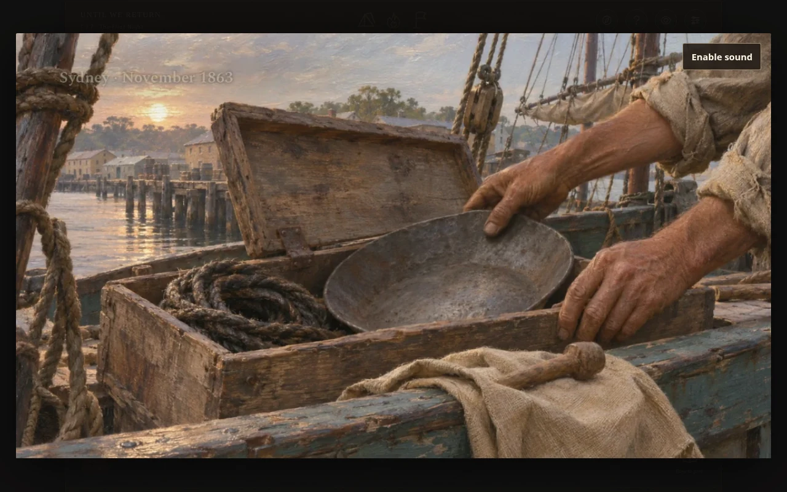
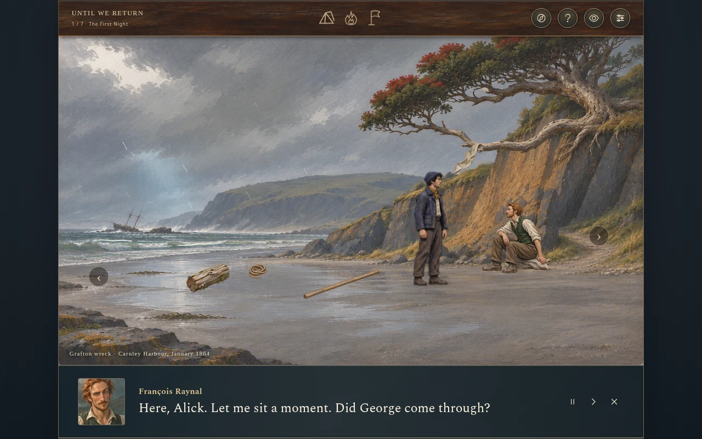

# Ze Sydney na první břeh

Na molu v Sydney vklouzne do bedny pánev na rýžování cínu. O několik týdnů později na Aucklandově ostrově záleží lidem ze stejné lodi na docela obyčejném kuse plachty. Mezi těmito dvěma okamžiky se z diváka stane hráč. Když skončí úvodní film, Raynal už sedí na břehu, chce si odpočinout a ptá se Alicka, zda viděl George. Při rozhovoru vidíš oba muže i věci, které vyplavilo moře. Až se rozejdou po práci, můžeš si některou z nich vzít do brašny.

## Kdo převezme vyprávění

| Po filmu | Co uvidíš nebo uslyšíš ve hře |
| --- | --- |
| První noc | Raynal si sedne a ptá se na George. Na pláži můžeš vzít lano a začít hledat způsob, jak sundat plachtu. |
| Zima v Epigwaittu | Henry našel Alickova červeného šachového jezdce stát ve vodě. Stopa vede hráče ke stropu a místu, kudy prosakuje déšť. |
| Výheň | Raynal stojí u studeného ohniště. Práci osádky určuje otázka, jak vyrobit vrták na otvory pro svorníky. |
| Člun | Nové hřeby mají posloužit člunu, který už muži mají. U skluzu začíná společná práce na jeho bocích. |
| Přeplavba | Alick s Raynalem hlídají kormidlo a Musgrave pracuje u pumpy. To, co muži sestrojili na souši, musí udržet na vodě. |
| Návrat pro dva muže | V Invercargillu se pohled přesune k Musgraveovi. Henry a George jsou pořád na ostrově a na kutr je třeba naložit zásoby. |
| Přistání a epilog | Musgrave s Crossem přistanou v člunu, zatímco *Flying Scud* zůstává pod plachtami. Po nalodění obou mužů následuje závěrečný film. Samostatné svědectví o *Invercauldu* se otevírá až v něm a v dobrovolném archivu. |

Vyplutí, obě ztroskotání, přestavba člunu a návrat pro Henryho a George vycházejí z dobových svědectví. Repliky, šachový jezdec nalezený ve vodě a ruční úkony v hádankách jsou součástmi dramatizace. [Prameny po jednotlivých záběrech](../../artwork/story-film/HISTORY.md) · [Historické hranice adaptace](../../HISTORICAL_ADAPTATION.md)

## Jak film pracuje s uloženou hrou

Nová hra spustí úvod sama. Běžnou uloženou hru otevřeš tam, kde jsi nechal postavu. Když kartu zavřeš uprostřed filmové části příběhu, hra si při povoleném místním ukládání poznamená i čas ve filmu. Kompas dovoluje znovu přehrát odemčenou část bez zásahu do práce posádky.

Přehrávání má anglický hlas, hudbu, ruchy a titulky. Některé prohlížeče dovolí zvuk až po prvním dotyku. V takovém případě se obraz rozběhne s titulky a **Enable sound** připojí zvuk na právě sledovaném místě. Ovládání lze vyvolat pohybem myši, dotykem nebo klávesou Tab. Při omezeném pohybu zůstává jedna malba po dobu záběru a vyprávění pokračuje dál. [Návod ke hře](../../README.md)

## Ověření vydání

Oba snímky nahoře pocházejí z průchodu stejným offline balíčkem, který má 140 819 577 bajtů. Jeho SHA-256 je `56392289ff25cc74e7f5d8f92bbcbbe0090129f7b07981f46af5f852aaeec5e4`. Prohlížeč v něm přehrál úvod po celých 66 sekund a po záchraně epilog po celých 59 sekund. V oddělené zkoušce jsme v Chromu a WebKitu zadrželi přenos nativního videa. Obraz pokračoval ze snímků původního filmu a v přehrávači se podařilo změřit zvuk. [Záznam ověření](../../FULL_GAME_TESTING.md) · [Kontroly vydání na GitHubu](https://github.com/OnFiala/auckland-castaways/actions/runs/44608134683)
