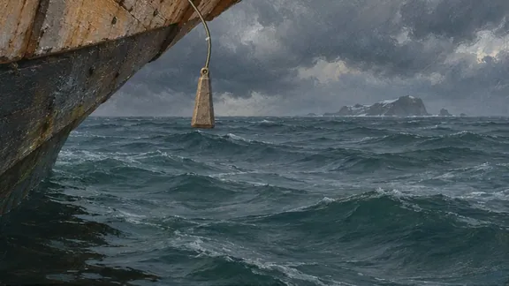

# The sea at the cabin table

The new film runs 4 minutes 8 seconds. Eight reels accompany the playable voyage. The opening spends sixteen shots on the passage from a Sydney wharf to the first night ashore. The complete edit has 63 shots across 23 narrated passages. Its H.264 master is 1280 × 720 at 24 frames per second. [Play the adventure](https://posledni-vrtak-auckland.andrewxix.chatgpt.site/) · [Complete English film](https://github.com/OnFiala/auckland-castaways/releases/download/game-v20/until-we-return-story-film.mp4)

The loaded case lifts clear of its shadow in Sydney. A sailor feeds a sounding line over the rail. Its heavy lead disappears beneath the water and the rope follows it. In the flooded cabin the overhead beam stays fixed while a lantern swings below it. Later the forge hammer hits hot iron and the mallet seats a fastening in the dinghy. Each contact has its own sound cue. [Picture edit](../../tools/story_film_cut.py) · [Recorded narration and sound](../../artwork/story-film/AUDIO.md)

Invercauld enters the telling with its own date, a printed map and Captain Dalgarno’s letter to the owners. The closing photographs show the wreck and Epigwaitt on the 1907 expedition. They were reprinted in 1909. The film identifies the photographs, their collection and the period of the final painted scene. [Film research](../../artwork/story-film/HISTORY.md) · [Provenance and rights](../../../sources/ILLUSTRATIONS.md)
