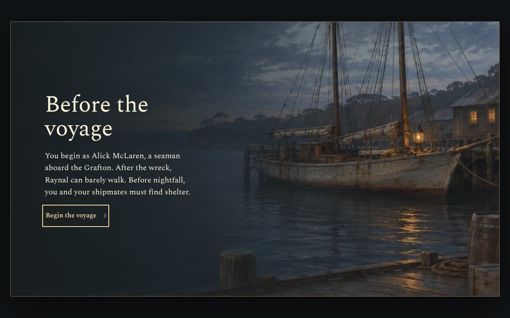
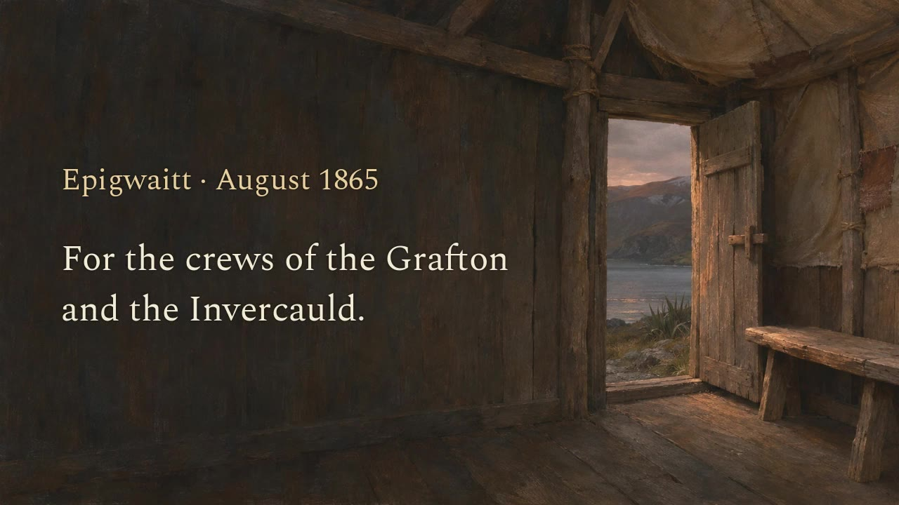

# Until We Return · Before the voyage

Při prvním spuštění máš čas přečíst si, koho budeš hrát. Jsi námořník Alick McLaren. Po ztroskotání Raynal sotva chodí a do setmění potřebujete pro posádku najít přístřeší. Volbou **Begin the voyage** příběh začne. Nad sydneyským přístavem se objeví název hry, datum a krátké představení posádky. První hlas zazní po šestnácti sekundách filmu.

Na telefonu se celý úvod vejde na obrazovku v obou polohách. [Úvod na výšku](foreword-portrait.jpg) · [Úvod na šířku](foreword-landscape.jpg)

Po posledním nalodění následuje večeře na palubě záchranného kutru. Vyprávění se potom vrátí k dřívějšímu ztroskotání na severu ostrova a k dopisům přeživších z *Invercauldu*. Po poslední větě zůstane v obraze na chvíli prázdný Epigwaitt. Závěrečné titulky věnují příběh oběma posádkám. Po doznění hudby si můžeš u archivního stolu prohlédnout dopisy i dobovou mapu. [Dopisy na archivním stole](../../EPILOGUE.md)

## The passage through the game

| Playable chapter | Where the story passes to the player |
| --- | --- |
| I · The First Night | After the landing at Carnley Harbour, Alick finds Raynal ill on the beach. A loose sail offers shelter for all five. |
| II · A House Against the Winter | The crew have built Epigwaitt. A drip inside the house gives Alick his first clue to what still needs mending. |
| III · What Iron Can Become | A length of timber lies ready for the keel. Alick and Raynal try to make the tool that could put a bolt through it. |
| IV · Room for Three | When the auger fails, the work moves to the schooner’s dinghy. Henry and George still need enough supplies to live on shore. |
| V · Five Days of Ocean | Alick, Raynal and Musgrave sail from Camp Cove. Working the rigging and keeping the water down brings them within sight of Stewart Island. |
| VI · The Promise | The player becomes Musgrave. John Macpherson’s collection in Invercargill helps him equip a return voyage with Captain Cross. |
| VII · Until We Return | At Epigwaitt, Henry and George can each tell Musgrave what happened while the others were away. Both must board before the closing film begins. |

Musgrave’s entry for 3 January describes a tent made from the schooner’s mainsail. The first playable chapter puts that sail within Alick’s reach. Later chapters give him work in the house and aboard the boat. The conversation is written for the game. [Full chapter script and historical choices](../../FULL_STORY.md) · [Film, scene by scene](../../artwork/story-film/HISTORY.md)

The eight films run for **4 minutes 42 seconds** altogether. The final film spends its last eighteen seconds in the empty shelter. The dedication appears at 0:59, the witnesses’ names at 1:05 and the expedition photograph credit at 1:11. The first and last cards were checked on the MP4, WebM and compatibility pictures at a display width of 320 pixels. [The eight-reel edit](../../dist/story-film-script.js)

## The people in the credits

François Raynal describes working on the Australian goldfields, hiring two seamen and a cook with Thomas Musgrave, and sailing from Sydney on **12 November 1863**. They meant to look for tin on Campbell Island and collect seal skins and oil. Their associates undertook to send a search if four months passed without their return. Raynal gives these details in the first two chapters of his memoir. [Raynal, *Wrecked on a Reef*, printed pp. 34–43](../../../sources/originals/wreckedonareef00rayngoog.pdf#page=45) · [Department of Conservation, the Grafton and its crew](https://www.doc.govt.nz/parks-and-recreation/places-to-go/southland/places/subantarctic-islands/auckland-islands/heritage-sites/grafton-wreck-and-epigwaitt/)

The closing titles name two writers from each ship. Thomas Musgrave kept the *Grafton* journal and Raynal later wrote his memoir. George Dalgarno wrote to the *Invercauld*’s owners and Andrew Smith to his wife. Their fellow survivor Robert Holding is named in the spoken film. The *Julian* carried the three north-coast survivors to Callao. Dalgarno went on to Southampton, where he wrote the account shown on screen. [Dalgarno’s letter](https://en.wikisource.org/wiki/Castaway_on_the_Auckland_Isles/Appendix_3) · [Smith’s letter in the *Otago Daily Times*, 21 October 1865](https://paperspast.natlib.govt.nz/newspapers/ODT18651021.2.18)

The photographs of the wreck timbers and overgrown house site date from the **1907 expedition**. The University of Washington Libraries hold the reproductions used in the film. The picture of the shelter that closes the credits is a modern painted reconstruction. [The two photographs and their provenance](../../../sources/ILLUSTRATIONS.md) · [Archaeological comparison, figures 11–12](https://www.doc.govt.nz/Documents/science-and-technical/has1entire.pdf#page=14)
