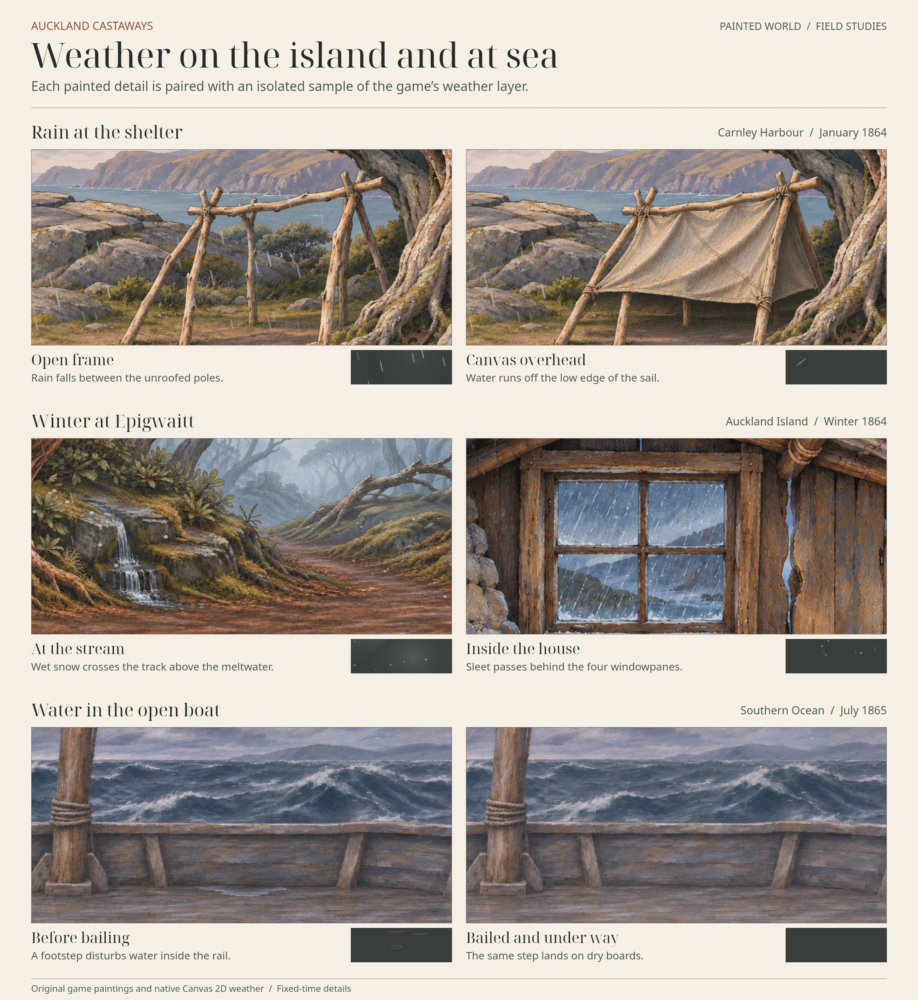

# Počasí na ostrově a na moři



Velké výřezy spojují aktuální herní malbu s počasím vykresleným stejným modulem, který používá hra. Malá tmavá políčka ukazují detail průhledné vrstvy počasí ze stejného okamžiku. Její původní barvy a průhlednost zůstávají při zvětšení zachovány. Snímek zachycuje samotné prostředí. Pohyb v čase je vidět v doprovodné animaci. [Animovaná ukázka](weather-in-motion.gif) · [Revize grafiky a počasí](../26-weather-and-art.md)

| Dvojice | Herní stav zobrazený na listu |
|---|---|
| Přístřešek v Carnley Harbour | Vlevo prší mezi holými kůly. Vpravo proběhla událost `shelterBuilt` a před 0,45 sekundou se spustila odezva na natažení plachty. Na volném okraji se uvolňuje voda. |
| Les a dům v zimě 1864 | U potoka padá mokrý sníh v několika hloubkách mezi stromy. V domě jsou pro déšť se sněhem vymezené čtyři samostatné okenní tabulky. Dřevěné příčky je překrývají. |
| Přeplavba v červenci 1865 | V obou záběrech je upevněné lanoví. Na stejné místo u dna byl 0,20 sekundy před zastavením položen krok. Vlevo zanechal stopu ve vodě. Vpravo už posádka vybrala vodu, opravila plachtu a určila kurz. Suché dno dává prázdný vzorek, tříšť nad vzdálenou obrubou člunu zůstává. |

Obraz vznikl v nativním Canvas 2D a má 2240 × 2440 pixelů. Generátor přebírá názvy maleb z herního výběru scén. Každý panel spustí vlastní instanci počasí a postupně ji posune o 37 animačních kroků po 50 ms. První krok nastaví časovou základnu, výsledný čas vrstvy je ve všech šesti výřezech 5,60 sekundy. Stejné časování umožňuje přímé srovnání. Tento způsob ověřuje obrazovou vrstvu bez postav, inventáře a prvků rozhraní. Plynulost při hraní v prohlížeči vyžaduje vlastní zkoušku. [Herní vykreslování počasí](../../dist/weather.js) · [Testy počasí a kontaktu se zemí](../../tests/weather.test.cjs) · [Volba maleb](../../dist/voyage-world.js)

## Opětovné vykreslení

List byl vytvořen s Node.js 24 a `@napi-rs/canvas` 0.1.100, s dostupnými rodinami písma Noto Serif Display a Noto Sans. Pro vytvoření stejného obrazu spusťte z kořene repozitáře následující příkazy. Jediným souborem, který generátor zapisuje, je `world-response.webp` v tomto adresáři. Souřadnice všech výřezů, použitá příznaková pole i kontrola suchého a mokrého dna jsou přímo v generátoru. [Zdroj listu](render.cjs)

```sh
weather_deps=$(mktemp -d)
npm install --prefix "$weather_deps" --no-save @napi-rs/canvas@0.1.100
NODE_PATH="$weather_deps/node_modules" node adventure/reviews/weather/render.cjs
```
