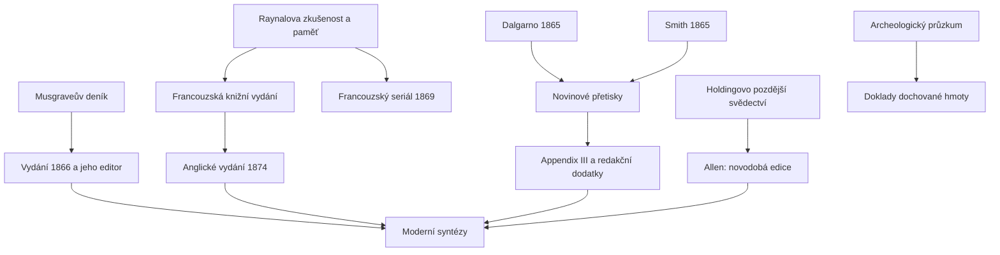

# Vydání, svědectví a metoda práce

## Co skutečně leží v repozitáři

Úplný Musgraveův londýnský sken z roku 1866 a úplný anglický Raynalův sken z roku 1874, včetně dobových ilustrací, jsou v [originals](../sources/originals/). Z Musgravea je odvozen strojový text, Raynal má dodané surové OCR. **Stažení celé knihy není tvrzení, že byla každá řádka přečtena a kolacionována.** Rozsah čtení je u každého ID v [registru](../sources/REGISTER.md). Pro citaci číslice nebo konkrétního výroku je rozhodující obraz stránky.

| Text | Ediční úroveň | Použití a omezení |
|---|---|---|
| Musgrave 1866, S001 | Vydaný deník s úvodem, editorem Shillinglawem a dodatky. | Kalendářní záznamy, materiální postupy, cesta a návrat. U každého tvrzení rozlišit deník / editor / převzatý dopis. Neprohlédnut původní rukopis. |
| Dalgarno, S002 | Dopis otištěný v dodatku Musgraveovy knihy. | Invercauld z pohledu kapitána. Následující poznámka vydavatelů o kouři je jiný hlas. |
| Raynal 1869, S003 | Francouzský seriál v *Le Tour du monde*, sv.20, pp.1–48. | Původní jazyk, cíleně přečtené části. Wikisource upozorňuje na stav korektur. Není to totožný rozsah jako pozdější kniha. |
| Raynal 1870, S023 | Katalog uvádí druhé francouzské vydání, viii + 374 stran, 40 ilustrací a mapu. | Záznam není přečtená kniha. První knižní vydání a jeho přesný vztah k seriálu zůstávají k bibliografickému ověření. |
| Raynal 1873, S024 | Třetí francouzské vydání, katalogový záznam. | Další ediční kontrolní bod, ne nové nezávislé svědectví. |
| Raynal 1874, S004 | Anglická kniha, T. Nelson & Sons, Oxford/Google/IA. | Čtené technické a závěrečné pasáže; překladatel není na prohlédnutém titulu identifikován. Překlad ani rozšíření nepřipisovat automaticky autorovu rukopisu. |
| Raynal 1894, S041 | Gallica, katalogová stopa sedmého vydání. | Obsah nedostupný při pokusu. Žádná tvrzení o variantách textu z této kopie. |
| Holding / Allen, S014–S015 | Moderní edice a vyprávění založené na pozdějším svědectví. | Prohlédnuty katalogy a anotace, nikoli rukopis nebo celá kniha. Nejsou zdrojem přímých Holdingových citací v tomto projektu. |

## Rodokmen informací

Šipky zde vyjadřují obecnou závislost, nikoli dokončenou filologickou stemmu všech vydání. Zejména přesná cesta jednotlivých dopisů mezi britským a novozélandským tiskem čeká na kontrolu. Tři přetisky kapitánova dopisu pořád představují jedno kapitánovo svědectví. Archeologická zpráva obsahuje jak nová fyzická pozorování, tak převzatý historický výklad; tyto části nemají stejnou nezávislost.

## Pracovní pravidla

- Každý důležitý údaj má ID S a lokátor: tištěná strana, datovaný zápis, paragraf nebo identifikátor novinového článku. Číslo stránky PDF je jiná veličina než tištěná strana.
- `fact` znamená tvrzení s uvedenou oporou, `inference` úsudek projektu, `fiction` vlastní tvůrčí konstrukci. Slova „určitě“ a „všichni“ potřebují zvláštní pozornost.
- Krátká citace z moderního zdroje nenahrazuje oprávnění kopírovat celé dílo. Z moderních knih jsou zde pouze bibliografické údaje a vlastní stručné poznámky.
- OCR chyby se opravují jen s dohledatelnou oporou. Původní soubor se nepřepisuje; oprava má jít do samostatného souboru s lokátorem a obrazovou kontrolou.
- Hodnotící nebo rasistické dobové výrazy se nepřebírají do neutrálního hlasu projektu. Při potřebném rozboru se připisují autorovi a vysvětlí.
- Nejistý údaj se nevyřeší většinovým hlasováním webů, které jej opisují ze stejné knihy. Protikladná svědectví se uchovávají vedle sebe.

Aktualizace nové rešerše má nejprve změnit registr a evidenci, pak chronologii, nakonec scénář. Dokud není opraven zdrojový záznam, pouhé přepsání README problém neřeší.

## Další primární kniha Invercauldu

Andrew Smith vydal v Aberdeenu roku 1866 **The Castaways** (S049); nalezena také digitální kopie NLA (S050). Google potvrzuje autora, rok a exemplář British Library. Nabízený PDF download vrátil HTTP403, NLA Anubis Access Denied. Samostatnou knihu proto zatím nepovažujeme za přečtenou. Srovnání Smitha a Dalgarna v této revizi stojí na jejich novinových dopisech (S038/S002), nikoli na předstíraném čtení knihy. S051 přidává přesné lokátory Smith1866 pp.10–11 a22 jako další vodítka ke kolaci.
