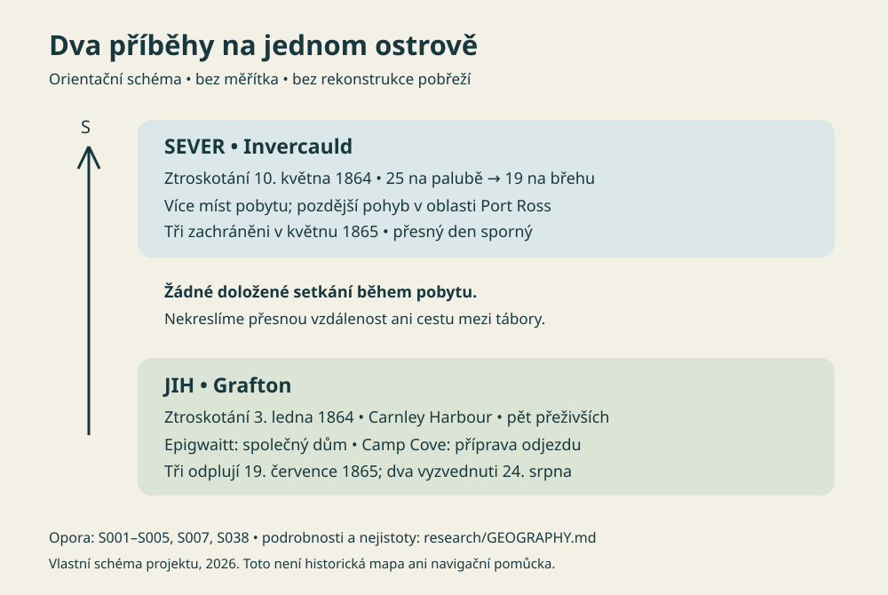

# Geografie a mapová jistota

Základní rozlišení je **jih: Grafton, Carnley Harbour / North Arm / Epigwaitt** a **sever: Invercauld a pozdější pohyb k oblasti Port Ross**. To neznamená, že známe přesný bod každého noclehu, průchodnou trasu mezi nimi nebo přímou vzdálenost táborů. Epigwaitt je jeden tábor; Invercauld má proměnlivou posloupnost míst. Přesun po souši ovlivňuje mokřad, hustá vegetace, svahy, obuv, zranění a viditelnost. Námořní spojení ovlivňuje člun, vítr a vlny. S001–S004, S038.

Schéma je vlastní vysvětlující grafika, nikoli odvozená historická mapa nebo navigační podklad. Je úmyslně bez obrysu pobřeží, měřítka a spojnice mezi tábory. Přesná mapa má vzniknout až po ověření dat LINZ a zaměření archeologického místa.

## Co říkají souřadnice

| Místo | Souřadnice / systém | Provenience | Jak se smí použít |
|---|---|---|---|
| Auckland Islands, reprezentativní bod souostroví | −50.583, 166.000; katalogový zeměpisný údaj | Te Papa, odkaz na Getty TGN, S029 | Pouze orientace souostroví. Není to tábor, vrak ani centroid hlavního ostrova. |
| Carnley Harbour, reprezentativní bod | −50.8374, 166.0763; desetinný zeměpisný údaj | S042, sekundární Wikipedia, revize uvedena v registru | Nízká míra prostorové jistoty; není ověřením lokality Epigwaittu. |
| Rossova observatoř, Sarah Harbour / Terror Cove | 50°32′30″ S, 166°12′34″ E | S001 Appendix II, p.163, převzatý historický údaj | Historický datum neznámý. Číselný převod −50.541667,166.209444 nečiní údaj moderním GPS měřením. |
| Epigwaitt a vrak Graftonu | Přesný bod v této revizi nepřevzat | Text S005/S006 a primární popis | V GeoJSON záměrně `geometry: null`. |
| Invercauld: vrak / první pobyt / pozdější přístřeší | Přesné body nerozhodnuty | S002/S038 | Žádný smyšlený bod a žádná přesná táborová vzdálenost. |

[places.geojson](../data/places.geojson) obsahuje jen dva orientační moderní katalogové body a položky s nulovou geometrií. Formát GeoJSON pracuje s pořadím **délka, šířka**. Katalogové souřadnice jsou pro zobrazení interpretovány jako WGS84; poskytovatelé v prohlédnutém údaji datum nepotvrdili, proto je tato interpretace výslovně uložena jako předpoklad. Historická observatoř je odděleně v [historical_coordinates.csv](../data/historical_coordinates.csv).

## Místa pro scénář

| Místo | Dramatická funkce | Historická mez |
|---|---|---|
| Vrak v Carnley Harbour | Materiál a riskantní práce mezi břehem a lodí. | Nezaměňovat s rychle roztříštěným Invercauldem. |
| Epigwaitt | Práce, domácnost, jednání, změna ročních období. | Datum nastěhování sporné, jméno má nejistou jazykovou etymologii. |
| Pobřežní loviště / les | Náklady na dopravu, počasí, orientace. | Pracovní herní zóny nejsou všechny skutečně georeferencované. |
| Camp Cove | Zkoušky, čekání a odjezd trojice. | Není synonymem Epigwaittu. |
| Port Adventure | Přijetí a první návrat do společnosti. | Nepřipsat vše jedinému evropskému zachránci; Raynal uvádí místní komunitu. |
| Invercargill | Získání prostředků a nové lodi. | Jde o činnost po úniku; stále zbývá splnit slib dvěma mužům. |
| Port Ross | Pozdější pátrání a nejistá identita mrtvého. | Jen po záchranném návratu; žádný doložený kontakt během pobytu. |

## Toponyma a záludnosti

Musgraveovo chybné Sarah’s Bosom je největší riziko automatické mapy: moderní vyhledávač pošle čtenáře na sever, přestože autor v dané části vypráví o jihu. U každého jeho zeměpisného odkazu je nutné posoudit datum a kontext plavby. „Epigwaitt“ má podle Musgravea být slovo ve smyslu obydlí u vody, ale jazyk ani původ této etymologie jsme neověřili. V marketingu hry proto nepoužívat tvrzení, že je to doložený místní maorský název. S001 pp.118–119 a Appendix II.

LINZ záznamy S027 a S028 byly nalezeny; dynamické rozhraní neposkytlo při této rešerši kontrolovatelný detail se souřadnicemi. Je to konkrétní další krok, nikoli důvod použít vymyšlenou přesnost. Možné trasy jsou zatím prostorová interpretace; oceánskou plavbu nekreslíme jako známý soubor každodenních GPS bodů.

## Roční období

Jde o jižní polokouli: prosinec–únor jsou léto, červen–srpen zima. Přestavba člunu od března do července1865 tedy probíhá od podzimu do zimy. Herní osvětlení, počasí a názvy kapitol nesmějí nevědomky používat evropský sezonní kalendář.
